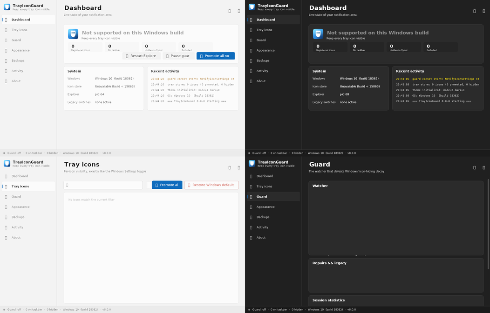
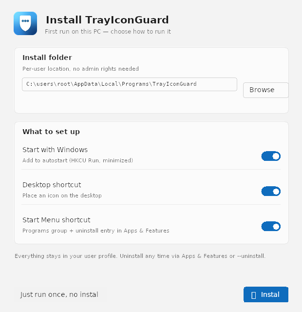
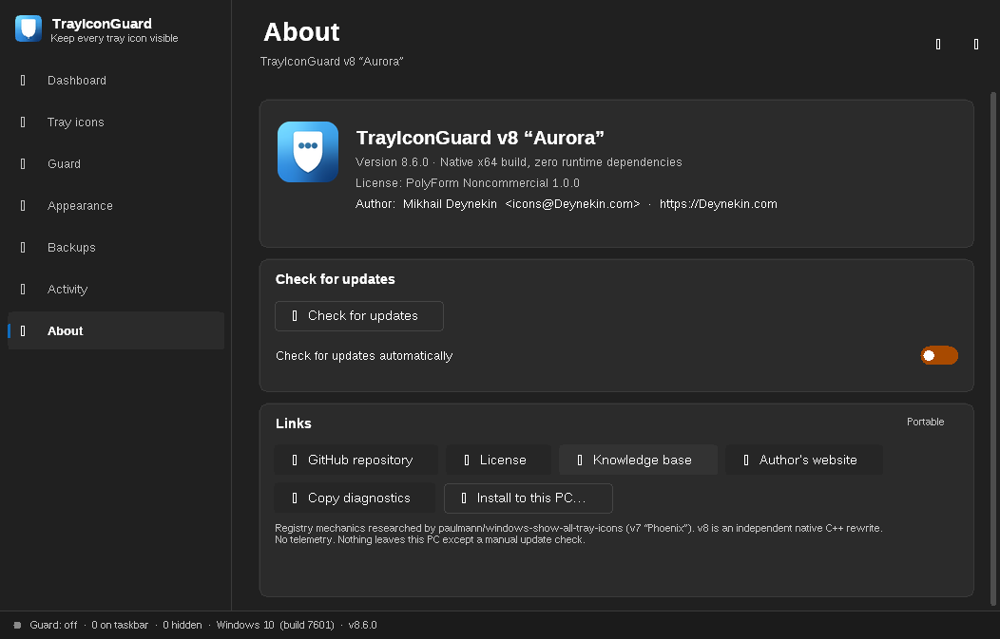

# TrayIconGuard v8 «Aurora» 🛡️✨

[](https://github.com/paulmann/windows-show-all-tray-icons/releases/latest)
[](LICENSE)
[](https://en.cppreference.com/w/)
[](docs/BUILD.md)
[](https://github.com/paulmann/windows-show-all-tray-icons/releases/latest)
[](https://www.microsoft.com/windows/)
[](https://github.com/paulmann/windows-show-all-tray-icons/actions/workflows/ci.yml)
[](https://github.com/paulmann/windows-show-all-tray-icons/releases)
[](https://github.com/paulmann/windows-show-all-tray-icons/stargazers)
📚 [Documentation site](https://paulmann.github.io/windows-show-all-tray-icons/) · [Knowledge base](https://github.com/paulmann/windows-show-all-tray-icons/wiki) · [docs/](docs/)

> **Windows 10/11 पर नोटिफ़िकेशन एरिया (सिस्टम ट्रे) के हर आइकन को दृश्य रखता है — और उन्हें
> दृश्य बनाए रखता है। एक ही नेटिव एक्ज़ेक्यूटेबल, शून्य निर्भरता, शून्य टेलीमेट्री।**

**अन्य भाषाओं में:** [English](README.md) · [Русский](README.ru.md) · [Deutsch](README.de.md) · [中文](README.zh.md) · [Español](README.es.md) · हिन्दी

TrayIconGuard उन आइकनों को टास्कबार पर वापस लाता है जिन्हें Windows ओवरफ़्लो फ़्लाआउट में छिपा
देता है — और एक **इवेंट-संचालित गार्ड** उसी क्षण उन्हें फिर से वापस लाता है जब Explorer उन्हें
दोबारा छिपाता है (ऐप शुरू, अपडेट, पुनः पंजीकरण)। यह ठीक वही रजिस्ट्री स्टोर लिखता है जिसका
प्रयोग Windows सेटिंग्स का टॉगल करता है — प्रति-उपयोगकर्ता, बिना एडमिन अधिकार के — और एक
**~1 MB के स्टैटिक लिंक्ड exe** में आधुनिक Fluent GUI, हेडलेस वॉचर मोड और पूर्ण CLI देता है,
जो सादे Windows पर चलता है।



---

## 📋 विषय-सूची

- [🚀 TrayIconGuard क्यों?](#-trayiconguard-क्यों)
- [✨ मुख्य विशेषताएँ](#-मुख्य-विशेषताएँ)
- [⚡ त्वरित प्रारंभ](#-त्वरित-प्रारंभ)
- [📦 स्थापना विकल्प](#-स्थापना-विकल्प)
- [🖥️ GUI का दौरा](#-gui-का-दौरा)
- [🧰 CLI संदर्भ](#-cli-संदर्भ)
- [🏗️ यह कैसे काम करता है](#-यह-कैसे-काम-करता-है)
- [🔄 Git से स्व-अपडेट](#-git-से-स्व-अपडेट)
- [🌍 भाषाएँ](#-भाषाएँ)
- [🌗 थीम और रूप-रंग](#-थीम-और-रूप-रंग)
- [🏢 परिनियोजन और स्वचालन](#-परिनियोजन-और-स्वचालन)
- [🔍 समस्या निवारण](#-समस्या-निवारण)
- [🛠️ सोर्स से बिल्ड](#-सोर्स-से-बिल्ड)
- [🗂️ रिपॉज़िटरी मानचित्र](#-रिपॉज़िटरी-मानचित्र)
- [🤝 योगदान](#-योगदान)
- [📄 लाइसेंस](#-लाइसेंस)
- [👨‍ लेखक और सहायता](#-लेखक-और-सहायता)
- [🎯 रोडमैप](#-रोडमैप)

---

## 🚀 TrayIconGuard क्यों?

Windows ट्रे-आइकन की दृश्यता प्रति-आइकन याद रखता है — और **लगातार भूल जाता है**: हर बार जब कोई
ऐप अपना नोटिफ़िकेशन आइकन (पुनः) पंजीकृत करता है, Explorer रजिस्ट्री सबकी को `IsPromoted=0` के
साथ दोबारा बनाता है, और आपके आइकन फिर `^` फ़्लाआउट में गिर जाते हैं। इसलिए एक-बार के ट्वीक और
`.reg` फ़ाइलें घंटों में ही निष्प्रभावी हो जाती हैं।

```text
# सादे Windows 10/11 पर वास्तव में क्या होता है
ऐप चलता / अपडेट / ट्रे आइकन पुनः पंजीकृत
        │
        ▼
Explorer HKCU\Control Panel\NotifyIconSettings\{id} दोबारा बनाता है
IsPromoted = 0 के साथ       ← आपका आइकन अभी छिपा
        │
        ▼
TrayIconGuard वॉचर (RegNotifyChangeKeyValue, ~400 ms डीबाउंस)
        │
        ▼
IsPromoted = 1 बहाल         ← आइकन तुरंत टास्कबार पर वापस
```

### वास्तविक लाभ

- **⚡ तत्काल**: पोलिंग नहीं, इवेंट-संचालित — आधे सेकंड से कम में सुधार
- **🎯 सटीक**: प्रति-आइकन नियंत्रण, अपवाद, क्रम के लिए ड्रैग, तीन दृश्यता मोड
- **🛡️ सम्मानजनक**: केवल HKCU, सामान्य उपयोगकर्ता, कभी एडमिन नहीं, कोई टेलीमेट्री नहीं, ऑटोस्टार्ट opt-in
- **📦 छोटा**: एक स्टैटिक exe (~1.05 MB) — न .NET, न रनटाइम, न रेडिस्ट्रिब्यूटेबल
- **🔁 स्व-उपचार**: Explorer रीस्टार्ट, ऐप अपडेट और लॉगऑन चक्रों को सह लेता है

## ✨ मुख्य विशेषताएँ

### 🛡️ **सटीकता और सुरक्षा**

- **सेटिंग्स-स्तरीय मैकेनिक्स** — `HKCU\Control Panel\NotifyIconSettings` में `IsPromoted`
  लिखता है, वही स्टोर जिसे Windows सेटिंग्स टॉगल उपयोग करता है
  (देखें [docs/HOW-IT-WORKS.md](docs/HOW-IT-WORKS.md))
- **JSON स्नैपशॉट** (स्कीमा v8), विनाशकारी क्रियाओं से पहले स्वचालित बैकअप,
  restore/export/delete प्रबंधक, 30 स्नैपशॉट धारण
- **ग्रेसेफुल डिग्रेडेशन**: पुरानी बिल्ड पर स्पष्ट स्थिति, विरासत विकल्प, कोई क्रैश नहीं
- **स्थिर एग्ज़िट कोड** (`0/1/2/3`) स्क्रिप्टिंग और RMM एकीकरण हेतु

### 🎯 **स्मार्ट गार्ड इंजन**

- **इवेंट वॉचर**: स्टोर सबट्री पर `RegNotifyChangeKeyValue` + डीबाउंस, वैकल्पिक पोलिंग
  फ़ॉलबैक, नए आइकन की खोज, पॉज़/रिज़्यूम
- **दृश्यता मोड**: *पूर्ण* (सब दिखें), *कस्टम* (प्रति-आइकन आपकी पसंद),
  *कॉम्पैक्ट* (TrayIconGuard को छोड़कर सब छिपे) — ट्रे मेनू या CLI से
- **प्रति-आइकन नियंत्रण**: प्रमोट/हाइड/एक्सक्लूड, वाइल्डकार्ड अपवाद (`onedrive.exe`, `*teams*`)
- **ड्रैग करके क्रम** बदलें, प्रति-PC सहेजा जाता है
- **सुरक्षित Explorer रीस्टार्ट** कूलडाउन और पुष्टि के साथ

### 🎨 **आधुनिक Fluent UI (2026)**

- कस्टम-ड्रॉन Win32/GDI+ इंटरफ़ेस: नेव रेल, कार्ड, एनिमेटेड टॉगल, सेगमेंटेड कंट्रोल,
  ओवरले स्क्रॉलबार, Per-Monitor-V2 DPI, Windows 11 राउंडेड कोर्नर और डार्क टाइटल बार
- **लाइट / डार्क / सिस्टम** थीम, क्विक स्विचर, सहेजा गया, पहली बार स्वतः पहचान
- **एक्सेंट रंग**: Windows का अनुसरण या 8 प्रीसेट
- रेस्पॉन्सिव लेआउट (860 px से कम पर नेव रेल सिकुड़ता है), पूर्ण कीबोर्ड नेविगेशन

### 📦 **अंतर्निहित इंस्टॉलर**

- प्रथम-रन विज़ार्ड: **स्कोप** (*केवल मेरे लिए* / *सभी उपयोगकर्ताओं के लिए* — एक UAC प्रॉम्प्ट),
  इंस्टॉल फ़ोल्डर, ऑटोस्टार्ट, डेस्कटॉप और स्टार्ट मेनू शॉर्टकट — या *केवल एक बार चलाएँ*
- “Apps & Features” में अनइंस्टॉल प्रविष्टि; `--uninstall` सब हटाता है (आवश्यक होने पर स्वतः एलिवेट)

### 🔄 **Git-आधारित स्व-अपडेट**

- इसी रेपो के `update/stable.json` के विरुद्ध opt-in जाँच, **SHA-256-पिन्ड** डाउनलोड,
  स्व-प्रतिस्थापन और रीलॉन्च; मैनुअल बटन + वैकल्पिक दैनिक ऑटो-जाँच (केवल बैलून)
- रिलीज़ इंजीनियरों के लिए प्रकाशन अनुबंध: [Updater_SKILL.MD](Updater_SKILL.MD)

## ⚡ त्वरित प्रारंभ

```text
# 1. नवीनतम रिलीज़ डाउनलोड करें (exe या zip)
https://github.com/paulmann/windows-show-all-tray-icons/releases/latest

# 2. अनब्लॉक (Mark-of-the-Web) करके चलाएँ — यही पूरी इंस्टॉलेशन है
TrayIconGuard.exe पर राइट-क्लिक → Properties → Unblock → OK
TrayIconGuard.exe

# 3. पहली बार: विज़ार्ड स्कोप / फ़ोल्डर / शॉर्टकट पूछता है
#    …या पोर्टेबल मोड हेतु “केवल एक बार चलाएँ” चुनें
```

हेडलेस / एक-पंक्ति:

```powershell
TrayIconGuard.exe --promote-all          # अभी सब दिखाएँ, फिर बाहर
TrayIconGuard.exe --watch                # हेडलेस गार्ड (बिना GUI), जैसे Task Scheduler से
TrayIconGuard.exe --status --json        # मॉनिटरिंग हेतु मशीन-पठनीय स्थिति
TrayIconGuard.exe --check-update         # git फ़ीड से पूछें कि नया संस्करण है या नहीं
```

## 📦 स्थापना विकल्प

| मोड | कैसे | एडमिन? | क्या मिलता है |
|---|---|---|---|
| **पोर्टेबल** | exe कहीं से भी चलाएँ | ❌ | `%APPDATA%` सेटिंग्स के अतिरिक्त कुछ नहीं |
| **प्रति-उपयोगकर्ता** (डिफ़ॉल्ट) | विज़ार्ड → *केवल मेरे लिए* | ❌ | `%LOCALAPPDATA%\Programs\TrayIconGuard`, HKCU Run ऑटोस्टार्ट, उपयोगकर्ता शॉर्टकट, Apps & Features प्रविष्टि |
| **सभी उपयोगकर्ता** | विज़ार्ड → *सभी उपयोगकर्ताओं के लिए* | ✅ एक बार (UAC) | `%ProgramFiles%\TrayIconGuard`, HKLM Run ऑटोस्टार्ट, साझा डेस्कटॉप/स्टार्ट मेनू शॉर्टकट, मशीन अनइंस्टॉल प्रविष्टि |

अनइंस्टॉल: *Apps & Features → TrayIconGuard*, या `TrayIconGuard.exe --uninstall`।



## 🖥️ GUI का दौरा

| पेज | क्या करता है |
|---|---|
| **डैशबोर्ड** | लाइव काउंटर (पंजीकृत / टास्कबार पर / छिपे / अपवर्जित), गार्ड स्थिति, एक-क्लिक क्रियाएँ, सिस्टम और हाल की गतिविधि कार्ड |
| **ट्रे आइकन** | खोज, फ़िल्टर, प्रति-आइकन टॉगल, अपवाद, ड्रैग-क्रम, पंक्ति संदर्भ मेनू |
| **गार्ड** | वॉचर ट्यूनिंग (डीबाउंस, पोलिंग, Explorer रीस्टार्ट नीति), विरासत मरम्मत, आँकड़े, अपवाद |
| **रूप-रंग** | थीम (लाइट/डार्क/सिस्टम), एक्सेंट, भाषा, एनिमेशन, कॉम्पैक्ट पंक्तियाँ |
| **बैकअप** | स्नैपशॉट सूची, बनाएँ/बहाल/निर्यात/हटाएँ, ऑटो-बैकअप टॉगल |
| **गतिविधि** | स्तर फ़िल्टर सहित लॉग व्यूअर, निर्यात, फ़ोल्डर खोलें |
| **परिचय** | संस्करण, अपडेट पैनल, लाइसेंस और नॉलेज बेस बटन, निदान प्रतिलिपि, इंस्टॉल-मोड चिप |

डार्क मोड, अपडेट पैनल और लिंक सहित «परिचय» पेज:



## 🧰 CLI संदर्भ

| कमांड | प्रभाव |
|---|---|
| *(कोई तर्क नहीं)* | ट्रे-निवासी GUI प्रारंभ |
| `--minimized` | नोटिफ़िकेशन एरिया में छिपा हुआ प्रारंभ |
| `--show` / `--toggle-guard` | चल रहे इंस्टैंस को IPC (सक्रिय / पॉज़-रिज़्यूम) |
| `--status [--json]` | ट्रे स्थिति छापकर बाहर |
| `--promote-all` | सभी छिपे आइकन प्रमोट करके बाहर |
| `--restore-defaults` | `IsPromoted` मान हटाएँ (नियंत्रण Windows को लौटाएँ) |
| `--restart-explorer` | सुरक्षित शेल रीस्टार्ट, फिर बाहर |
| `--backup` / `--restore-latest` | JSON स्नैपशॉट बनाएँ / बहाल करें |
| `--watch` | हेडलेस गार्ड लूप (इवेंट-संचालित, बिना GUI) |
| `--install-autostart` / `--uninstall-autostart` | HKCU Run प्रविष्टि प्रबंधन |
| `--install-machine <dir> [--autostart] [--desktop] [--menu]` | सभी-उपयोगकर्ता इंस्टॉल बॉडी (एलिवेटेड चलना आवश्यक) |
| `--uninstall` | शॉर्टकट, ऑटोस्टार्ट और इंस्टॉल कॉपी हटाएँ (मशीन इंस्टॉल हेतु स्वतः एलिवेट) |
| `--mode full\|custom\|compact` | ट्रे दृश्यता मोड सेट करें |
| `--check-update` / `--update-now` | git फ़ीड जाँच / गैर-इंटरैक्टिव अपडेट |
| `--version` / `--help` | आत्म-परिचय |

**एग्ज़िट कोड:** `0` ok · `1` अमान्य तर्क · `2` असमर्थित OS · `3` आंशिक विफलता।

## 🏗️ यह कैसे काम करता है

प्राथमिक स्टोर (Windows 10 1703+ / 11), प्रति-उपयोगकर्ता, बिना एडमिन:

```text
HKCU\Control Panel\NotifyIconSettings\{<icon-id>}
    IsPromoted            DWORD      1 = टास्कबार पर, 0 = ओवरफ़्लो फ़्लाआउट में
    ExecutablePath       REG_SZ     स्वामी प्रक्रिया
    IconResource         REG_SZ     पथ,-id
    IconSnapshot         REG_BINARY कैश किया गया चित्र
    LastNotificationAddedTime  REG_QWORD
```

विरासत दोहरी-सुरक्षा (वैकल्पिक): `EnableAutoTray=0` और `HKCU\…\Policies\Explorer` के अंतर्गत
`HideSCA*` नीतियों का हटाना। पूर्ण शोध, क्षय-विश्लेषण और «न छुएँ» सूची (`StuckRects3` आदि):
[docs/HOW-IT-WORKS.md](docs/HOW-IT-WORKS.md)।

## 🔄 Git से स्व-अपडेट

- फ़ीड: `main` पर [`update/stable.json`](update/stable.json) (स्कीमा, sha256 पिन, नोट्स)
- क्लाइंट: WinHTTP डाउनलोड → BCrypt SHA-256 सत्यापन → रीनेम-चेन स्व-प्रतिस्थापन → रीलॉन्च
- कभी चुपचाप नहीं: मैनुअल अपडेट पर पुष्टि संवाद; ऑटो-जाँच opt-in, ≤ 1 बार/24 घंटे, केवल बैलून
- CI फ़ीड को **उन बाइट्स से पिन करता है जो रिलीज़ वास्तव में परोसती है** (`scripts/make_feed.py`),
  इसलिए फ़ीड और एसेट कभी विसंगत नहीं हो सकते — देखें [Updater_SKILL.MD](Updater_SKILL.MD)

## 🌍 भाषाएँ

30 लोकेल, प्रति-स्ट्रिंग अंग्रेज़ी फ़ॉलबैक और पहली बार OS भाषा की स्वतः पहचान के साथ
(**रूप-रंग → भाषा** में लाइव स्विच):

| | | | |
|---|---|---|---|
| English (डिफ़ॉल्ट) | Русский | 中文 (简体) | हिन्दी |
| Español | Deutsch | Français | Português |
| 日本語 | 한국어 | Italiano | العربية |
| Indonesian | اردو | Türkçe | Tiếng Việt |
| Polski | ไทย | Українська | Nederlands |
| Română | Ελληνικά | Čeština | Svenska |
| Magyar | Suomi | Dansk | עברית |
| فارسی | বাংলা | | |

विवरण और अनुवाद गाइड: [docs/I18N.md](docs/I18N.md)।

## 🌗 थीम और रूप-रंग

- **लाइट / डार्क / सिस्टम** — सहेजे गए, पहली बार स्वतः पहचान, टाइटल बार में क्विक स्विचर;
  Windows 11 इमर्सिव डार्क टाइटल बार और राउंडेड कोर्नर
- **एक्सेंट**: Windows रंगीनकरण का अनुसरण या 8 अंतर्निहित प्रीसेट
- **गति**: 140 ms टॉगल स्लाइड और होवर स्थितियाँ (अक्षम करने योग्य), कॉम्पैक्ट-रो मोड
- सर्वत्र Per-Monitor-V2 DPI-सही

## 🏢 परिनियोजन और स्वचालन

- **Task Scheduler / GPO लॉगॉन स्क्रिप्ट**: `TrayIconGuard.exe --watch` (हेडलेस) या
  `--minimized` (ट्रे में GUI)
- **RMM / मॉनिटरिंग**: `--status --json`, स्थिर एग्ज़िट कोड, `%LOCALAPPDATA%\TrayIconGuard\logs`
  में 14-दिन के रोटेटिंग लॉग
- **फ़्लीट-सुरक्षित**: per-user स्कोप हेतु एडमिन नहीं चाहिए; machine स्कोप हेतु एलिवेटेड
  संदर्भ से `--install-machine`
- Store-तैयार: [`store/`](store/) में MSIX मैनिफ़ेस्ट + एसेट + पैकिंग स्क्रिप्ट — देखें
  [docs/STORE.md](docs/STORE.md)

## 🔍 समस्या निवारण

| लक्षण | समाधान |
|---|---|
| स्टार्ट पर «side-by-side कॉन्फ़िगरेशन गलत» | exe को `*.exe` नामक फ़ोल्डर में खोला गया या अनब्लॉक नहीं; देखें [docs/TROUBLESHOOTING.md](docs/TROUBLESHOOTING.md) |
| पहली बार SmartScreen चेतावनी | बिना हस्ताक्षर बाइनरी हेतु अपेक्षित: Properties → Unblock; साइनिंग गाइड [docs/SMARTSCREEN.md](docs/SMARTSCREEN.md) में |
| किसी ऐप अपडेट के बाद आइकन फिर छिप गए | गार्ड पॉज़्ड? ट्रे मेनू → *पॉज़/रिज़्यूम*; गतिविधि पेज वॉचर इवेंट दिखाता है |
| अपडेट अस्वीकृत: sha256 mismatch | फ़ीड/एसेट ड्रिफ़्ट — [Updater_SKILL.MD](Updater_SKILL.MD) §3 के अनुसार पुनः प्रकाशित करें |
| Win10 < 1703 पर कुछ प्रमोट नहीं | स्टोर असमर्थित; ऐप बताता है और विरासत स्विच प्रस्तुत करता है |

अधिक: [docs/TROUBLESHOOTING.md](docs/TROUBLESHOOTING.md) · [wiki FAQ](https://github.com/paulmann/windows-show-all-tray-icons/wiki)

## 🛠️ सोर्स से बिल्ड

```bash
# Linux पर क्रॉस-कंपाइल (स्टैटिक, स्ट्रिप्ड, शून्य-निर्भरता exe)
sudo apt install g++-mingw-w64-x86-64 cmake
./scripts/build.sh          # गेट: 0 चेतावनी, मैनिफ़ेस्ट जाँच, केवल-OS-DLL ऑडिट
./scripts/package.sh        # zip + SHA256SUMS

# या Windows पर नेटिव MSVC
cmake -S . -B build -G "Visual Studio 17 2022" -A x64
cmake --build build --config Release
```

CI हर push पर दोनों चलाता है (ubuntu cross + windows MSVC) और `v*` टैग पर रिलीज़ प्रकाशित करता है।
विवरण: [docs/BUILD.md](docs/BUILD.md)।

## 🗂️ रिपॉज़िटरी मानचित्र

| पथ | सामग्री |
|---|---|
| `src/core` | इंजन: रजिस्ट्री स्टोर, गार्ड, explorer, बैकअप, ऑटोस्टार्ट, इंस्टॉलर, अपडेटर, CLI |
| `src/ui` | Fluent किट, पेज, विज़ार्ड, ट्रे, थीम, 30 लोकेल i18n |
| `docs/` | इंजीनियरिंग और उपयोगकर्ता दस्तावेज़ (HOW-IT-WORKS, CLI, DESIGN, I18N, STORE, SMARTSCREEN…) |
| `store/` | MSIX मैनिफ़ेस्ट + Store एसेट + `make_msix.ps1` |
| `scripts/` | बिल्ड/पैकेज/फ़ीड टूलिंग (`build.sh`, `package.sh`, `make_feed.py`) |
| `installer/` | एंटरप्राइज़ पैकेजिंग हेतु वैकल्पिक ps1/bat/Inno सहायक |
| `update/` | लाइव अपडेट फ़ीड (`stable.json`) |
| `.github/workflows/ci.yml` | गेट + रिलीज़ + फ़ीड पिनिंग पाइपलाइन |

## 🤝 योगदान

Issues और PR सादर आमंत्रित हैं। कृपया बनाए रखें: शून्य रनटाइम निर्भरता, केवल-HKCU सुरक्षा मॉडल,
चेतावनी-मुक्त बिल्ड गेट (`-Wall -Wextra`) और `Updater_SKILL.MD` का फ़ीड अनुबंध।
योगदान नियमों के लिए [`CONTRIBUTING.md`](CONTRIBUTING.md) और [आचार संहिता](CODE_OF_CONDUCT.md) देखें; सुरक्षा समस्याओं के लिए [`SECURITY.md`](SECURITY.md) देखें।

## 📄 लाइसेंस

[PolyForm Noncommercial License 1.0.0](LICENSE) — गैर-व्यावसायिक उपयोग हेतु स्वतंत्र;
व्यावसायिक लाइसेंसिंग हेतु लेखक से संपर्क करें।

## 👨‍💻 लेखक और सहायता

**Mikhail Deynekin** · <icons@Deynekin.com> · [Deynekin.com](https://Deynekin.com) ·
[GitHub](https://github.com/paulmann) ·
[नॉलेज बेस (wiki)](https://github.com/paulmann/windows-show-all-tray-icons/wiki) ·
[लाइसेंस](https://github.com/paulmann/windows-show-all-tray-icons/blob/main/LICENSE)

## 🎯 रोडमैप

- [ ] कोड-साइनिंग पाइपलाइन (SmartScreen प्रतिष्ठा)
- [ ] अरबी/हिब्रू/फ़ारसी/उर्दू हेतु RTL लेआउट मिररिंग
- [ ] SCCM/Intune Win32 ऐप्स हेतु MSI पैकेजिंग
- [ ] नेटिव ARM64 बिल्ड

---

<sub>सुथरी टास्कबारों के लिए 🧧 के साथ बनाया गया। TrayIconGuard Microsoft से संबद्ध नहीं है।</sub>
